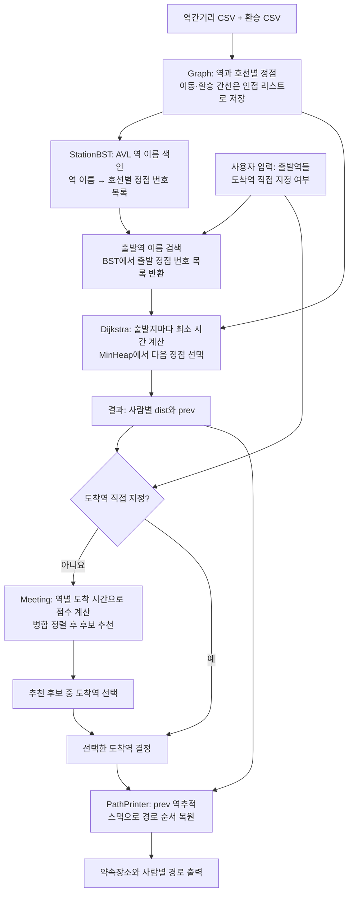

# 시스템 아키텍처

여러 사람의 출발역을 입력받아 약속장소를 추천하고, 사람별 경로를 안내하는 프로그램의 구조를 설명합니다. 아래 그림은 **목표 흐름**이며, 일부 기능은 아직 구현 또는 연결 중입니다.

## 전체 흐름

그래프 연결 상태를 확인하는 BFS·큐 기능은 `PathPrinter`에서 별도로 수행하는 목표 기능입니다. 동적 배열은 특정 단계 하나가 아니라 필요한 모듈에서 공통으로 사용할 수 있는 저장 자료구조입니다.

## 모듈별 역할

| 모듈 | 입력 | 역할과 출력 |
|---|---|---|
| `Graph` | 역간거리·환승 CSV | 역과 호선 조합을 정점으로, 이동·환승을 가중치 간선으로 구성합니다. 정점별 간선은 인접 리스트에 저장합니다. |
| `StationBST` | 역 이름과 그래프 정점 번호 | AVL 트리에서 역 이름을 찾아 해당 이름의 호선별 정점 번호 목록을 반환합니다. |
| `DynamicArray<T>` | 저장할 자료형의 원소 | `<vector>` 없이 원소를 연속된 동적 공간에 저장합니다. 사용 방법은 [DynamicArray 사용 안내](DynamicArray.md)를 참고하세요. |
| `Dijkstra` | 그래프와 한 사람의 출발역에 해당하는 정점 번호 목록 | 모든 정점까지의 최소 시간 `dist`와 직전 정점 `prev`를 계산하는 목표 기능입니다. |
| `MinHeap` | 거리와 정점 번호 | 다익스트라가 아직 처리할 후보 중 거리가 가장 작은 항목을 고르는 데 사용합니다. |
| `Meeting` | 그래프와 사람별 `dist` | 역별로 사람들의 도착 시간을 비교해 후보 점수를 계산하고 병합 정렬합니다. |
| `PathPrinter` | 그래프, `dist`, `prev`, 도착 정점 | `prev`를 역추적해 경로를 복원하고 출력하는 목표 기능입니다. BFS를 이용한 연결 검사도 담당합니다. |
| `main` | CSV 경로와 사용자 입력 | 각 모듈을 순서대로 호출하고 결과를 연결합니다. |
